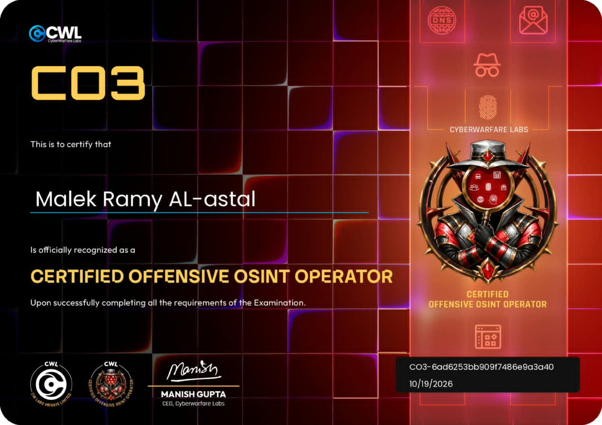

# Eng.Malek Ramy Alastal

> **Cybersecurity Student & Offensive Security Enthusiast** | Founder & Lead at **mSec.urity**

---

## 🏆 Professional Certifications & Credentials

### Certified Offensive OSINT Operator (CO3)

* **Candidate Name:** Malek Ramy Alastal (م. مالك رامي الأسطل)
* **Certification:** Certified Offensive OSINT Operator (CO3)
* **Issuer:** CyberWarFare Labs (CWL)
* **Status:** Successfully Verified & Completed

---

## 🛡️ About Me
I am Malek Ramy Alastal, a cybersecurity student at the University College of Applied Sciences (UCAS) and the founder of **mSec.urity**. My core focus areas include offensive security, Open-Source Intelligence (OSINT), threat analysis, and digital forensics. 

* **Initiative:** [mSec.urity](https://github.com/malek-alastal)
* **Domain:** Information Security & Ethical Hacking

---
